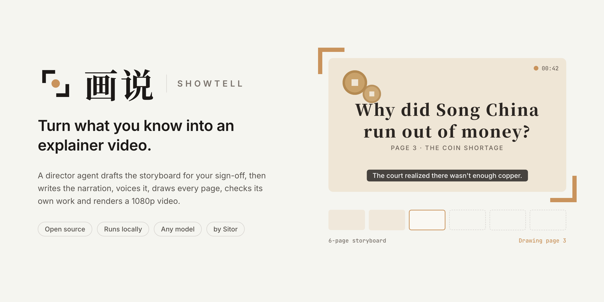

<p align="center">
  <picture>
    <source media="(prefers-color-scheme: dark)" srcset="docs/brand/readme/banner-en-dark.png">
    
  </picture>
</p>

<p align="center">
  <b>English</b> · <a href="README.zh-CN.md">简体中文</a>
</p>

**Showtell** (画说, *huà shuō*) turns your documents, PDFs, slides and images into an explainer video with pages that move. A director agent first drafts a storyboard for you to sign off on. Then it writes the narration, voices it, draws each page and checks its own work. You get a 1080p video, with subtitles and publishing notes.

It's built for knowledge creators who explain history, science, technology, investing, psychology or books, and who'd rather tell the story than learn video editing.

> **Status:** in active development. See the [roadmap](docs/ROADMAP.md) and [architecture](docs/ARCHITECTURE.md).

## Why Showtell

- **You approve the plan first.** Nothing gets drawn until you've signed off on the storyboard. If a page is wrong, point at it and say what to change.
- **You can watch it work.** The agent says what it's doing and why, and the cost and time spent are on screen at every step.
- **Stable results, fewer tokens.** The agent drives a mature video engine with styles, components, camera moves and quality checks. It doesn't generate video from scratch.
- **Runs locally, with any model.** Your materials and API keys stay on your computer. It works with [Relay](https://relay.example.com) (recommended), Anthropic, OpenAI and other providers.

## How it works

1. **Materials.** Drop in a document, PDF, slide deck, images or Markdown.
2. **Storyboard.** The director breaks your material into pages and story beats, and you approve or edit them.
3. **Narration and voice.** It writes the script and voices it with Volcengine TTS or ElevenLabs.
4. **Pages.** It draws every page in the style you chose and checks each one with lint and screenshots.
5. **Film.** It runs a final check on the full video, then renders a 1080p MP4 with subtitles.

Built-in styles: `warm-story`, `study`, `chalkboard`, `whiteboard`, `tech-dark`.

## Quick start

You need Node.js 22.19 or later, pnpm, and Chrome, Edge or Chromium installed. FFmpeg is bundled.

```bash
git clone <this repo> && cd <repo>
pnpm install && pnpm build

export RELAY_API_KEY=...          # or ANTHROPIC_API_KEY / OPENAI_API_KEY
export VOLCENGINE_TTS_API_KEY=...    # optional, or ELEVENLABS_API_KEY for voiceover

# Open the studio in your browser
node apps/cli/dist/cli.js serve

# Or make a video straight from the command line
node apps/cli/dist/cli.js run notes.pdf --style warm-story --duration 60
```

## License

[MIT](LICENSE) · Made by **Sitor**
