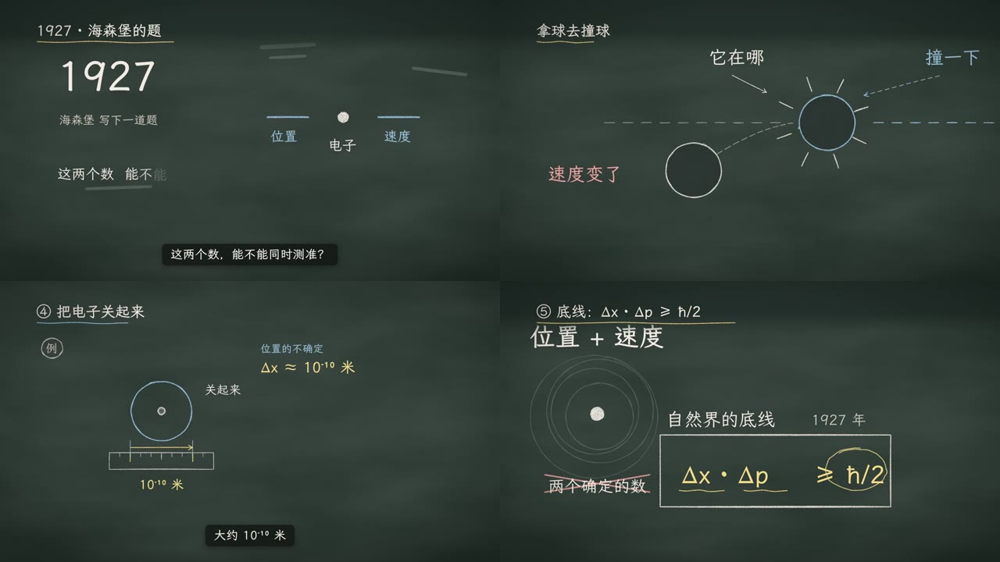
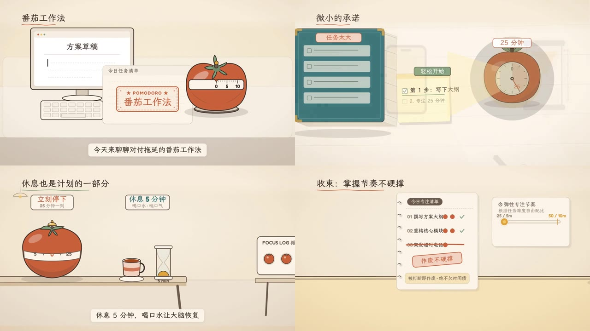

<p align="center">
  <picture>
    <source media="(prefers-color-scheme: dark)" srcset="docs/brand/readme/banner-zh-dark.png">
    
  </picture>
</p>

<p align="center">
  <a href="README.md">English</a> · <b>简体中文</b>
</p>

**画说**（Frametell）把文档、PDF、PPT 和图片变成一条画面会动的讲解视频。导演 Agent 先出分镜给你拍板，再写口播、配音、逐页作画并自检，最后渲染成 1080p 成片，附带字幕和发布信息。

它是给知识创作者用的：讲历史、科学、技术、投资、心理学、读书的人。你只管把事情讲清楚，不用学剪辑。

> **状态：** 开发中。进度见 [路线图](docs/ROADMAP.md)，架构见 [ARCHITECTURE.md](docs/ARCHITECTURE.md)。

## 看看效果

下面两条片子都是画说从头做到尾的：分镜、口播、配音、每一页画面和渲染。点图片观看（有声音）。

<table>
  <tr>
    <td width="50%"><a href="docs/media/uncertainty.mp4"></a></td>
    <td width="50%"><a href="docs/media/pomodoro.mp4"></a></td>
  </tr>
  <tr>
    <td><b>测不准原理</b> · 67 秒，<code>chalkboard</code> 黑板风格。只给了一句话「讲讲量子力学测不准原理」，模型是 DeepSeek。</td>
    <td><b>番茄工作法</b> · 55 秒，<code>warm-story</code> 暖调插画风格。素材是一页笔记，模型是 Gemini 3.7 Flash（经 Relay）。</td>
  </tr>
</table>

## 为什么用画说

- **先拍板，再动手。** 分镜确认之前一页都不画。哪一页不对，指着它说改什么就行。
- **过程看得见。** Agent 边做边说在干什么、为什么这么做，花了多少钱、用了多久，任何时候一眼可见。
- **效果稳，省 token。** 不是从零生成视频，而是驱动一整套成熟的视频引擎：风格、组件、镜头运动、质量检查都是现成的。
- **本地运行，任何模型。** 资料和密钥都留在你的电脑上。支持 [Relay](https://relay.example.com)（推荐）、Anthropic、OpenAI 等。

## 怎么做出来的

1. **资料**：交给它文档、PDF、PPT、图片或一段 Markdown。
2. **分镜**：导演把资料拆成一页页、一个个拍点，你确认或修改。
3. **口播与配音**：写好讲稿，用火山 TTS 或 ElevenLabs 配音。
4. **逐页画面**：按你选的风格画每一页，用 lint 和截图逐页自检。
5. **成片**：全片检查后渲染 1080p MP4，带字幕。

内置风格：`warm-story`（暖调叙事）、`study`（安静书房）、`chalkboard`（黑板）、`whiteboard`（白板）、`tech-dark`（深色科技）。

## 快速开始

需要 Node.js 22.19 以上、pnpm，以及本机装有 Chrome、Edge 或 Chromium。FFmpeg 已内置。

```bash
git clone <本仓库> && cd <仓库目录>
pnpm install && pnpm build

export RELAY_API_KEY=...          # 或 ANTHROPIC_API_KEY / OPENAI_API_KEY
export VOLCENGINE_TTS_API_KEY=...    # 可选，配音用；也可以用 ELEVENLABS_API_KEY

# 在浏览器里打开工作室
node apps/cli/dist/cli.js serve

# 或者直接在命令行出一条视频
node apps/cli/dist/cli.js run 讲稿.pdf --style warm-story --duration 60
```

## 社区

用画说做了片子、遇到问题、想要新风格，都欢迎来群里聊。扫码加入画说交流群：

<p align="center">
  
</p>

Bug 和功能建议也可以直接提 [Issue](../../issues)。

## 许可

[MIT](LICENSE) · **Sitor Team** 出品
